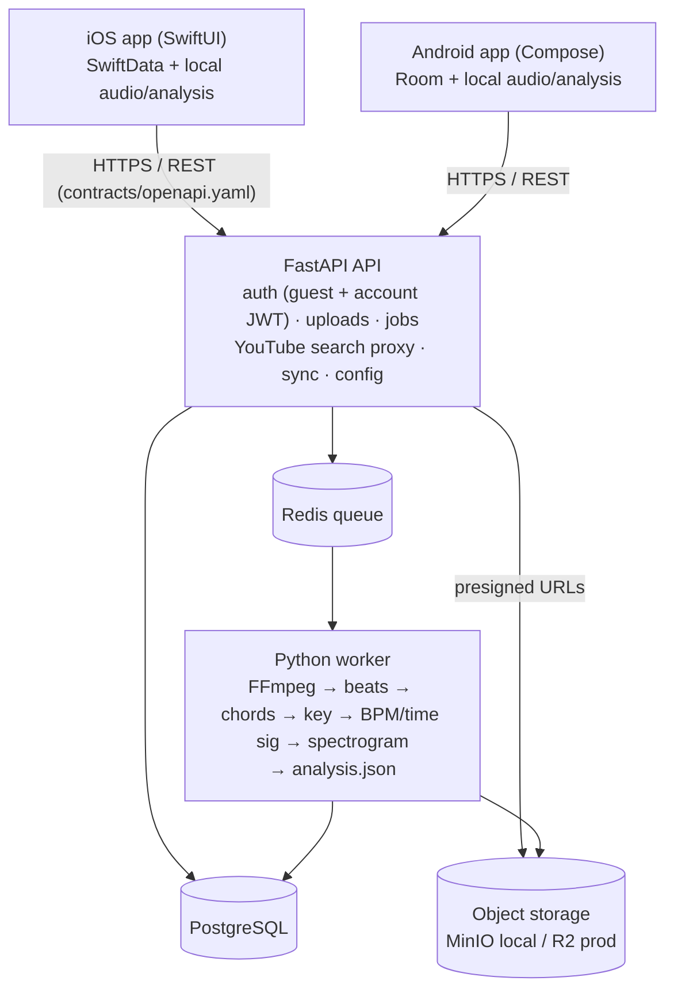

# MusicDecoded

[](#license)
[](https://github.com/AblazedTC/musicDecoded/actions/workflows/contracts.yml)
[](https://github.com/AblazedTC/musicDecoded/actions/workflows/api.yml)
[](https://github.com/AblazedTC/musicDecoded/actions/workflows/worker.yml)
[](https://github.com/AblazedTC/musicDecoded/actions/workflows/android.yml)
[](https://github.com/AblazedTC/musicDecoded/actions/workflows/ios.yml)

Turn any song into chords you can follow. Pick a file, record audio, or find a song on YouTube or SoundCloud. MusicDecoded transcribes the beats, chords, key, BPM and time signature, then shows them on a scrolling player with a piano that plays along. Transcriptions are saved on your phone and work offline. An account is optional and only adds sync across devices.

## Architecture



Apps talk only to the API; audio and analysis files move through presigned object-storage URLs. Analysis is
cached globally, so a song that was already transcribed costs nothing. Details in [PLAN.md §5](PLAN.md#5-architecture).

Want to help? Start with [CONTRIBUTING.md](CONTRIBUTING.md).

## Start here

| File | What it's for |
|---|---|
| [PLAN.md](PLAN.md) | Vision, v1 scope, architecture, decisions, risks, milestones |
| [TASKS.md](TASKS.md) | The work board |
| [DESIGN.md](DESIGN.md) | Screens and player spec |
| [contracts/](contracts) | API (`openapi.yaml`), analysis file format, chord voicings, fixtures |

## Stack

| Layer | Technology |
|---|---|
| iOS | Swift, SwiftUI, SwiftData, AVFoundation |
| Android | Kotlin, Jetpack Compose, Room, Media3 |
| API | Python, FastAPI, SQLAlchemy, JWT |
| Worker | Python, FFmpeg, PyTorch (Beat Transformer, CNN-LSTM chords) |
| Data | PostgreSQL, Redis, S3-compatible storage (MinIO / R2) |

## Structure

```
apps/
  android/   Kotlin Android app
  ios/       Swift iOS app
  api/       FastAPI API
  worker/    Python ML worker
contracts/   shared interfaces: openapi.yaml, analysis.schema.json, chord-voicings.json, fixtures/
docs/        architecture, data model, user flows, running locally
```

## Running locally

See [docs/running-locally.md](docs/running-locally.md).

```bash
docker compose up db -d
cd apps/api && APP_ENV=dev uv run uvicorn app.main:app --reload --port 8080
```

> **Upgrading from the old Spring Boot API?** Its local `users` table is missing the new columns, and the API
> only creates missing tables (migrations arrive with T-101). Reset the dev database with `docker compose down -v`,
> which **deletes all local Postgres and MinIO data**.

## License

| Part | License |
|---|---|
| iOS app, Android app, `contracts/`, docs | [MIT](LICENSE) |
| `apps/api`, `apps/worker` | [AGPL-3.0](apps/api/LICENSE) |

Contributions to `apps/api` and `apps/worker` need a signed CLA (see [CONTRIBUTING.md](CONTRIBUTING.md#licensing-and-the-cla)).
"MusicDecoded" and its logo are not covered by these licenses. Forks must use a different name. See [PLAN.md §9](PLAN.md#9-open-source--monetization) for how the free and Pro plans work.

## Docs

| Doc | Description |
|---|---|
| [architecture.md](docs/architecture.md) | Components, request lifecycle, security, hosting |
| [data-model.md](docs/data-model.md) | On-device storage, Postgres, object storage, Redis, queue message |
| [user-flows.md](docs/user-flows.md) | Step-by-step flows for every feature |
| [running-locally.md](docs/running-locally.md) | Local setup |
